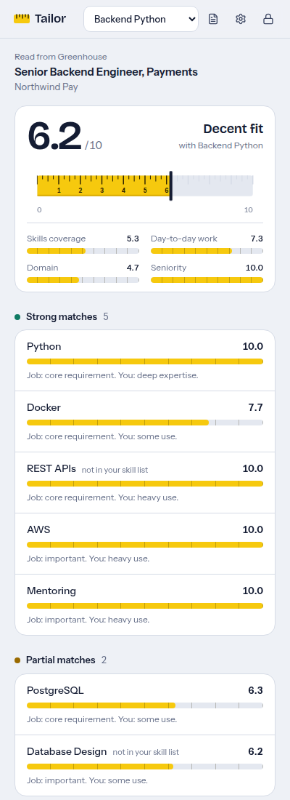
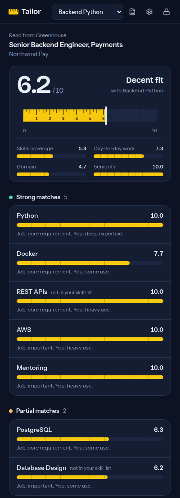
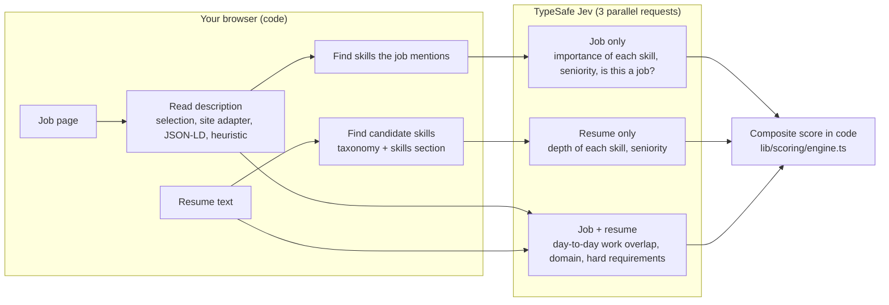

# Tailor

**How well does this job fit you?** Tailor is a browser extension that measures your resume against the job posting you have open, on LinkedIn, Naukri, a company career page, or anywhere else. You get one score from 0 to 10 and a score for every skill: where you're strong, where you're thin, and what the job wants that your resume doesn't show.

- **0** means no match. **10** means the job could have been written for you.
- Keep several resumes (say, "Backend Python" and "Full-stack JS") and see which one fits a job best.
- **Local-first.** Resumes, scores, and your API key stay in your browser. There is no Tailor server.
- Scoring runs on [TypeSafe Jev](https://docs.typesafe.ai/introduction), a model that returns typed judgments (scores, choices, yes/no probabilities) instead of text. You bring your own API key.

<p>
  
  
</p>

## Install

Tailor isn't in the stores yet. Build it from source (Node 20+):

```bash
git clone <this repo> tailor && cd tailor
npm install
npm run build          # Chrome, Edge, Brave, Arc: output in .output/chrome-mv3
npm run build:firefox  # Firefox 128+ (experimental): .output/firefox-mv3
```

**Chrome / Edge / Brave:** open `chrome://extensions`, turn on **Developer mode**, click **Load unpacked**, pick `.output/chrome-mv3`. Pin Tailor to the toolbar.

**Firefox:** open `about:debugging#/runtime/this-firefox`, **Load Temporary Add-on**, pick `.output/firefox-mv3/manifest.json`.

## Use

1. Click the Tailor icon. The side panel opens.
2. **Connect Jev.** Paste your TypeSafe API key ([get one here](https://console.typesafe.ai/keys)) and choose a passphrase. Tailor checks the key, encrypts it, and saves only the encrypted form.
3. **Add a resume** (PDF, DOCX, TXT, or Markdown, or paste the text). Tailor finds candidate skills, Jev confirms each one against your resume, and you review the list.
4. Open a job posting and click **Measure this job**. If Tailor reads the wrong part of a page, select the description text and measure again: a selection always wins.

## How the score works

Jev never writes a score explanation or does arithmetic. It answers narrow questions; Tailor combines the answers in plain code you can read. Every question, rubric, threshold, and weight lives in one file: [`lib/jev/questions.ts`](lib/jev/questions.ts).



**Per skill.** Jev rates how important the skill is to the job (4 levels, from "not asked for" to "core requirement") and how much depth your resume shows (5 levels, from "not mentioned" to "deep expertise"). A skill scores 10 when your depth meets what its importance calls for: core requirements expect heavy use, nice-to-haves are satisfied by a listing.

**Overall.** A weighted mean of:

| Part | Weight | From |
|---|---|---|
| Skills coverage | 55% | Per-skill matches, weighted by how much the job needs each skill |
| Day-to-day work | 25% | How much of the described work you've already done |
| Domain | 10% | How close your industry is to the job's |
| Seniority | 10% | Your level against the level they're hiring for |

Parts Jev can't judge (say, the posting doesn't state a level) are left out and the rest re-weighted. If Jev thinks the posting has a hard requirement you clearly don't meet (a degree, clearance, language, or location), the score is capped at 5 and flagged.

**Why this design.** It follows TypeSafe's own guidance: one narrow judgment per question, arithmetic in code, the smallest state that answers each question, and code that over-finds candidates so Jev can verify them (Jev can't generate a skill name, so it can only keep what code found). Answers are cached per resume and per job, so re-measuring or switching resumes usually costs nothing.

## Privacy

| Data | Where it lives | Leaves your browser? |
|---|---|---|
| Resumes | IndexedDB in the extension | Sent to TypeSafe when you import (to verify skills) and when you measure |
| Job text | Memory; cached answers keyed by a hash | Sent to TypeSafe when you measure |
| API key | Encrypted in extension storage; unlocked copy in session memory | Only to TypeSafe, as the request credential |
| Scores and cached Jev answers | IndexedDB in the extension | Never |

Tailor reads a page **only when you click Measure**, using `activeTab`. It never runs on pages in the background and has no analytics. Read [PRIVACY.md](PRIVACY.md) and TypeSafe's own policies before sending a resume you consider sensitive.

## Security

Your key is sealed with **AES-256-GCM** under a key derived from your passphrase with **PBKDF2-SHA256 at 600,000 iterations**, both from the browser's WebCrypto. The decrypted key exists only in the background worker's memory and `storage.session` (cleared when the browser closes, unreadable by content scripts), locks automatically after inactivity, and is never sent to the side panel or to any web page. Only this extension's own pages may call the background, and the only network destination allowed by the extension's content security policy is `api.typesafe.ai`. Details and the threat model: [SECURITY.md](SECURITY.md).

A note on keys: TypeSafe recommends keeping API keys on a server. That advice protects a *developer's* key from the visitors of a website. Tailor's key belongs to you, is used only by you, and runs in the extension's isolated background context, not in a web page, so the risk the SDK warns about doesn't apply in the same way. Still, use a key dedicated to Tailor and set a spending limit in the TypeSafe console.

## Develop

```bash
npm run dev         # Chrome with hot reload
npm run dev:firefox
npm test            # unit tests: engine, skill finder, vault crypto, pipeline, page reader
npm run typecheck
npm run check       # typecheck + tests + production build (what CI runs)
```

```
entrypoints/
  background.ts        Only place the API key and Jev calls live
  extractor.ts         Injected into the job page on demand
  sidepanel/           The UI (React)
lib/
  jev/questions.ts     Every question, rubric, threshold, and weight
  jev/client.ts        Official @typesafe-ai/sdk, batching and error mapping
  scoring/engine.ts    Pure composite scoring (unit-tested)
  scoring/pipeline.ts  Which questions to ask, caching
  skills/              Taxonomy and candidate finder
  job/                 Page reading: adapters per job site, JSON-LD, heuristic
  vault/               Key encryption and lock state
  resume/parse.ts      PDF / DOCX / text parsing, all local
components/            Side panel views
```

## Contributing

The two easiest, most useful contributions are **site adapters** (so Tailor reads more job boards precisely) and **taxonomy entries** (so more skills are found). See [CONTRIBUTING.md](CONTRIBUTING.md).

## Limitations

- Scores depend on the skill list. Review it when you import a resume.
- Jev's answers are calibrated judgments, not facts. Treat 6.2 and 6.5 as the same.
- Scanned (image-only) PDFs have no text to read; paste the text instead.
- Site layouts change. When an adapter breaks, Tailor falls back to structured data and then to its heuristic, and a text selection always works.

## License

MIT. Tailor is an independent project and is not affiliated with TypeSafe AI.
